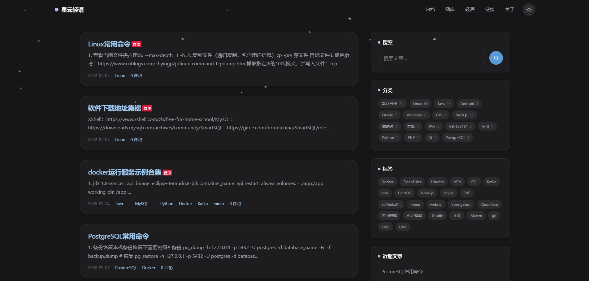
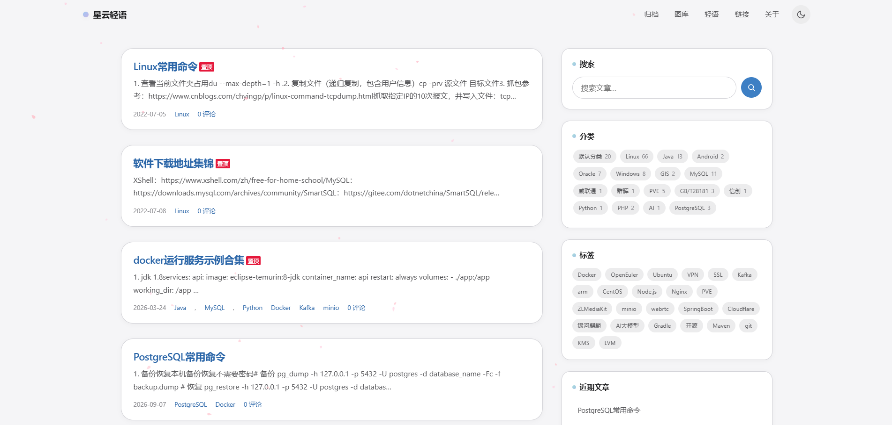
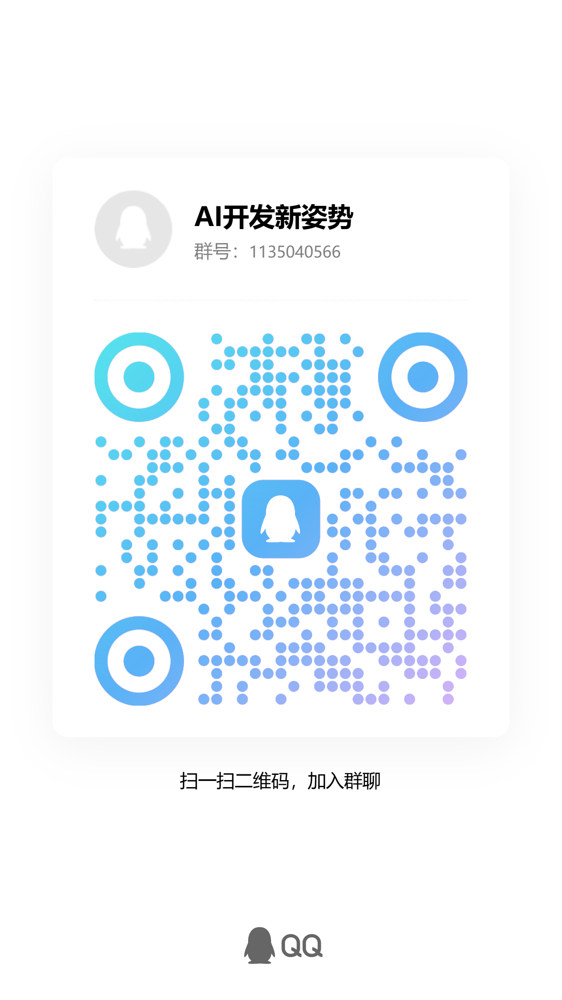

# Macaron · Typecho 马卡龙主题

> 苹果现代审美 + 马卡龙柔和配色，主打文字阅读的轻量 Typecho 博客主题。
> 大量留白、大圆角、柔和阴影、低饱和配色，浅色与深色双模式，CSS 变量驱动。

适配 Typecho **v1.3.0**。

- Typecho 仓库：<https://github.com/typecho/typecho.git>
- 主题开发文档：<https://docs.typecho.org/develop/theme/>

---

## 特性

- **马卡龙配色 · 双模式**：浅色通透、深色低亮度灰调，颜色/圆角/间距/阴影全部 CSS 变量化，一键切换。
- **主题记忆**：深浅切换记忆本地选择，下次访问自动恢复；支持「跟随系统」。
- **克制动效**：平缓过渡曲线、平滑滚动；尊重系统「减少动效」偏好。
- **毛玻璃顶栏**：`backdrop-filter` 固定导航，滚动时浮现柔和阴影；不支持时优雅回落。
- **长文目录（TOC）**：文章页自动生成侧边/悬浮目录，识别 H1~H6 全部标题并按实际最高层级动态定级。
- **代码块增强**：语言标签、一键复制，浅色/深色双主题适配。
- **响应式**：手机端自动重排，导航折叠为汉堡菜单，触控友好。
- **原生能力**：保留 Typecho 原生搜索、评论、Feed 与插件钩子，无破坏性改造。

## 安装教程

1. 下载主题源码。
2. 将本主题整个目录上传到站点的 `usr/themes/` 下，得到 `usr/themes/typecho-macaron/`。
3. 登录 Typecho 后台 → **控制台 → 外观 → 主题**，找到 **Macaron** 并启用。
4. 点击「设置外观」进入后台主题面板，按需配置（见下）。
5. 前台刷新即见效果；右上角按钮可随时切换深浅色。

## 导航链接示例

```
首页|/
归档|/index.php/archives/
关于|/index.php/about/
```

## 主题截图

- 深色模式
<div style="text-align: center">

</div>

- 浅色模式

<div style="text-align: center">

</div>

## 技术交流

<p>

</p>

> 点击链接加入群聊【AI开发新姿势】：https://qm.qq.com/q/ACxOjcQQqA

> 作者完全不会PHP开发，本项目100%由AI开发，感兴趣可以加群交流AI相关技术

## 开源协议

本项目基于 **GNU Affero General Public License v3.0（AGPL-3.0）** 开源，详见 [LICENSE](LICENSE)。

> 该协议要求任何基于本主题分发或对外提供网络服务衍生版本时，同样以 AGPL-3.0 公开完整源码。
